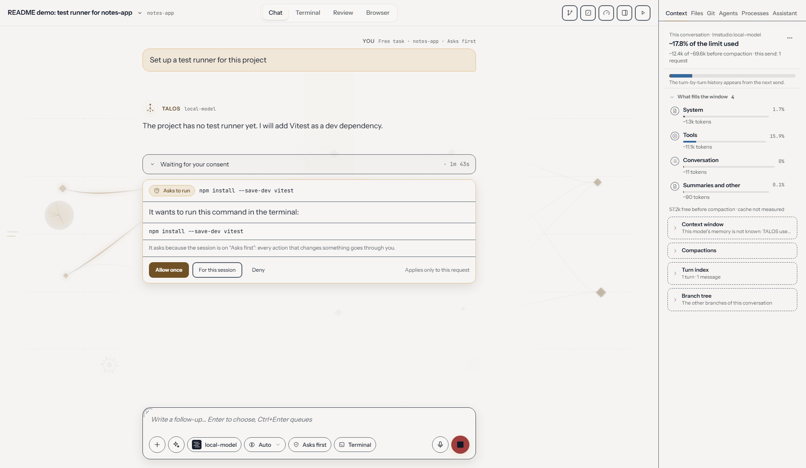
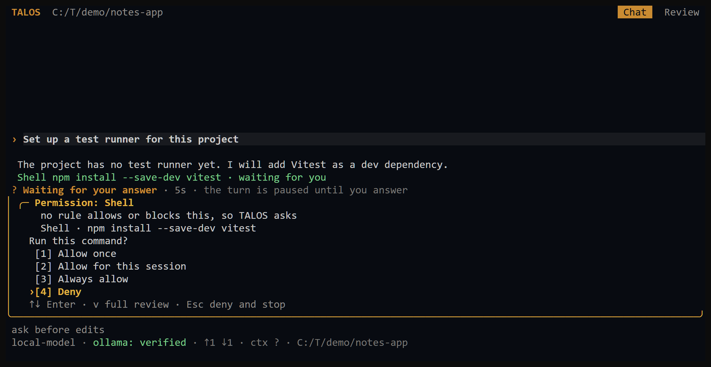

<p align="center">
  <picture>
    <source media="(prefers-color-scheme: light)" srcset="mobile/docs/immagini/talos-logo-chiaro.png">
    
  </picture>
</p>

<p align="center">
  <strong>An agent for your PC, your terminal and your Android phone. It asks before it acts.</strong>
</p>

<p align="center">
  <a href="https://www.talos-code.com/"><strong>www.talos-code.com</strong></a>
</p>

<p align="center">
  Three apps: on your Windows PC, in your terminal, and on your Android phone.
  Each one asks before it does what you have not allowed, and you decide how much it may do on its own.
</p>

<p align="center">
  <a href="LICENSE"></a>
</p>

*La versione italiana è più sotto.*

---

## Three apps

| | **TALOS Desktop** (PC) | **TALOS CLI** (terminal) | **TALOS Mobile** (phone) |
|---|---|---|---|
| What it is | A Windows app for coding and everyday work: chat, terminal, review, browser, notes, library | A coding agent in your terminal: it reads, edits and runs code in your project | A personal agent for Android that reasons, remembers, researches and acts on the device; it also has a coding agent, Code |
| Latest release | **0.2.4** (20 November 2026) | **0.6.18** (21 November 2026) | **0.1.49** |
| Where to get it | [Releases](https://github.com/Ninozzz95/talos/releases), tag `desktop-v0.2.4` | npm package [`talos-code`](https://www.npmjs.com/package/talos-code), command `talos` | [Releases](https://github.com/Ninozzz95/talos/releases), tag `mobile-v0.1.49` |
| Runs on | Windows 11 x64 (Windows 10 1809 or later declared, not yet tested); Node.js is included | Node.js 24 (24.18 or later in the 24 line); tested on Windows 11 x64 | Android 8.0 or later, `arm64-v8a` |
| Models | The provider you choose, or a local GGUF model | OpenAI, Anthropic, Google Gemini, DeepSeek, OpenRouter and 17 more cloud providers; Ollama, LM Studio and llama.cpp locally, with no key | A GGUF model on the device, or the cloud model you choose |
| What changed | [Desktop changelog](harness-ui/desktop/CHANGELOG.md) | `CHANGELOG.md` inside the npm package | [Mobile changelog](CHANGELOG.md) |

**What they share, and what they do not share yet.** The PC app, the CLI and Code on the phone are built on one core:
the part that decides whether an action may run, shows you the permission card and tells the model what happened. The
released apps do not carry the same version of it today: the PC 0.2.4 and the CLI 0.6.18 carry the same core, and the
phone 0.1.49 carries the earlier one of the PC 0.2.3. On the phone only Code uses this core; the Chat runs on its own
engine, with its own checks. For example, the PC 0.2.4 and the CLI 0.6.18 ask Google not to store your Gemini chat
requests, when you reach Gemini at Google's own address with your key; the phone does not yet.

**What changes.** The screen and the place it lives: a window on the PC, a terminal, a phone. The phone also acts on the
device itself (torch, alarms, settings, other apps); the CLI works on the code of your project.

## Permissions, in plain words

**On the PC** you pick one of four levels for each session:

- **Read only** — it reads the project and runs commands that change nothing. Every write is refused.
- **Writes to the project** (recommended) — it writes on its own inside the session folder. It asks you before writing a
  file outside it, and before a command that writes or deletes outside it (the system temp folder excepted). A command that writes
  only inside the session folder runs without that question.
- **Asks first** — it asks you before every action that leaves a trace: writes, commands, network.
- **Full access** — files and network without the ordinary gates. Use it only when you already know what it is about to do.

Some things ask whatever the level: for example deleting a whole drive, a top folder, your user folder or the project.
TALOS reads the command, and scripts written inside it, and asks. A web address that contains one of your saved keys,
written as saved, is refused in every level.

When TALOS needs your yes, a card shows what it wants to do (for a command, the exact command). You answer
**Allow once**, **For this session**, or **Deny**. When a command writes outside the project, the card offers only **Allow once** and
**Deny**: a yes for the whole session would cover more than what the card shows.

<p align="center">
  <picture>
    <source media="(prefers-color-scheme: dark)" srcset="harness-ui/docs/immagini/readme-pc-scuro.png">
    
  </picture>
  <br><em>TALOS Desktop on «Asks first»: the card shows the exact command and waits for your answer.</em>
</p>

If you say no, nothing runs. The chat shows «You said no», and the model is told that you said no, that it must not ask
again unless you bring it up, and that it should go on without it or tell you in one line what it can do instead. In an
automatic session where nobody can answer, the action is refused.

In Full access, a folder TALOS has not asked about brings the question «Trust this folder?» before the first turn; if you
say No, it works there as in Asks first, and that folder's instructions, hooks and connected tools stay off.

**In the CLI** every tool asks before it acts unless you have allowed it. Each tool is allowed, asked or denied, per
project, and the modes are `default`, `acceptEdits`, `plan`, `auto`, `dontAsk` and `bypassPermissions`. `/undo` restores
the files a turn changed, from checkpoints kept outside your repository and outside Git.

<p align="center">
  
  <br><em>The CLI asks the same way: the command, then your choice.</em>
</p>

**On the phone**, Code has the levels of the PC with the same names, on the core of the PC 0.2.3: with «Writes to the
project», writing a file outside the session folder asks you, while a command asks only for sensitive places (home, the
project, the phone's folders), not for every folder outside. For a tool of a connector, a plugin or Tool Forge, the card on
the device offers «Allow once» and «Deny».
In the rest of the app every tool declares whether it reads, writes or sends something out, with allow, ask or deny for
each, and where the result can be observed, success depends on what actually happened.

## Known limits

Each release lists what it still does not do in its notes. The main ones today:

- **PC 0.2.4.** The permission check reads what a command says; it is not a sandbox: a program that writes files by
  itself is not seen, and some ways of writing a command are not read yet. The installer is not code-signed, so Windows SmartScreen may warn you. On a small context window
  with many tools, a request can be refused once as too large; TALOS summarizes and sends it again, and nothing is lost.
- **CLI 0.6.18.** The permission check reads a command as it is written; it is not a sandbox. Only Windows 11 x64 is
  tested. Context compaction with a local Ollama model is not yet verified end to end. A local provider that answers
  401/403 without needing a key can be set aside as if its key were wrong.
- **Phone 0.1.49.** The fixes of this version are in Code; the Chat still runs on its own engine, with its own checks.
  The Assistant and the folder trust of the PC app are not on the device. If the keyboard is open when a permission card
  appears, the card can scroll out of view and show only its buttons: close the keyboard and read the whole card before
  you choose. The new card for tools of connectors, plugins and Tool Forge is tested in the code, not yet live on a device.
- **Privacy policy.** [PRIVACY.md](PRIVACY.md) covers the PC app only; the phone app and the CLI are not covered yet.

## Install

**PC** — download `TALOS-Setup-<version>.exe` from [Releases](https://github.com/Ninozzz95/talos/releases) (tags
`desktop-v*`), or extract the complete `TALOS-<version>-win.zip` and open `TALOS.exe`. Compare the files with
`SHA256SUMS.txt` attached to the release:

```powershell
Get-FileHash -Algorithm SHA256 .\TALOS-Setup-<version>.exe
gh attestation verify .\TALOS-Setup-<version>.exe --repo Ninozzz95/talos
```

The installer is not code-signed: Windows may show «Windows protected your PC». After checking the hash, choose
**More info → Run anyway**; keep SmartScreen and Defender on. [Desktop guide →](harness-ui/desktop/README.md)

**CLI** — with Node.js 24:

```bash
npm i -g talos-code
talos
```

The first time, a short guided setup asks only what is missing: whether to trust the folder, then a provider, its key and
a model.

**Phone** — download the signed APK from [Releases](https://github.com/Ninozzz95/talos/releases) (tags `mobile-v*`),
check it, and confirm the install from an unknown source. An app already on 0.1.46 or later updates itself to 0.1.49.

```bash
sha256sum TALOS-<version>.apk
gh attestation verify TALOS-<version>.apk --repo Ninozzz95/talos
```

[Mobile guide →](mobile/README.md)

## Local-first

Telemetry: none.

On its own, TALOS Desktop goes online only to check for updates on GitHub and, once the user picks an OpenRouter model, adds its key or turns it on (it is off by default, and an administrator setting can keep it off for the whole computer), to read OpenRouter's public model list; everything else happens because the user chose it.

## Code signing policy

- Not signed yet: TALOS Desktop releases are published as unsigned files today. Once code signing is in place, the files that will be signed are the Windows release binaries of TALOS Desktop built by this repository's release workflow (the app executable, the installer and the uninstaller). Third-party binaries shipped unchanged will keep their upstream state.
- Committers and reviewers: [Ninozzz95](https://github.com/Ninozzz95) (single maintainer)
- Approvers: [Ninozzz95](https://github.com/Ninozzz95); every signing request will be approved manually.
- Privacy policy: [PRIVACY.md](PRIVACY.md), for the PC app only; the phone app and the CLI are not covered yet.

## Repository map

- [`harness-ui/`](harness-ui/README.md) — TALOS Desktop: the local service, the interface and the Windows app ([`harness-ui/desktop/`](harness-ui/desktop/README.md)).
- [`mobile/`](mobile/README.md) — the Android app.
- [`context-engine/`](context-engine/) — the context component used by the desktop.
- [CHANGELOG.md](CHANGELOG.md) (phone) · [harness-ui/desktop/CHANGELOG.md](harness-ui/desktop/CHANGELOG.md) (PC) · [Code of Conduct](CODE_OF_CONDUCT.md) · [Contributing](mobile/CONTRIBUTING.md) · [Security](mobile/SECURITY.md)

Report vulnerabilities through this repository's private security reporting ([how](mobile/SECURITY.md)).

## License

TALOS is licensed under **AGPL-3.0-only**, across the monorepo. If you modify TALOS and let users interact with that modified version over a network, you must offer those users its corresponding source code, including your changes, free of charge.

See [LICENSE](LICENSE) and [NOTICE](NOTICE). Third-party components retain their own licenses: [monorepo notices](THIRD_PARTY_NOTICES.md), [desktop notices](harness-ui/THIRD_PARTY_NOTICES.md), and [context-engine notices](context-engine/THIRD_PARTY_NOTICES.md).

---

# TALOS — in italiano

**Un agente per il PC, il terminale e il telefono Android, che chiede prima di agire.** Tre app: sul PC Windows, nel terminale e sul telefono Android.
Ognuna chiede prima di fare ciò che non hai consentito, e decidi tu quanto può fare da sola.

## Tre app

| | **TALOS Desktop** (PC) | **TALOS CLI** (terminale) | **TALOS Mobile** (telefono) |
|---|---|---|---|
| Che cos'è | Un'app per Windows per programmare e per il lavoro di tutti i giorni: chat, terminale, revisione, browser, note, libreria | Un agente di programmazione nel terminale: legge, modifica ed esegue il codice del tuo progetto | Un agente personale per Android che ragiona, ricorda, cerca e agisce sul dispositivo; ha anche un agente di programmazione, Codice |
| Ultima uscita | **0.2.4** (20 novembre 2026) | **0.6.18** (21 novembre 2026) | **0.1.49** |
| Dove si prende | [Releases](https://github.com/Ninozzz95/talos/releases), tag `desktop-v0.2.4` | pacchetto npm [`talos-code`](https://www.npmjs.com/package/talos-code), comando `talos` | [Releases](https://github.com/Ninozzz95/talos/releases), tag `mobile-v0.1.49` |
| Dove gira | Windows 11 x64 (Windows 10 1809 o successivo dichiarato, non ancora provato); Node.js è incluso | Node.js 24 (24.18 o successivo nella serie 24); provata su Windows 11 x64 | Android 8.0 o successivo, `arm64-v8a` |
| Modelli | Il fornitore che scegli, o un modello GGUF locale | OpenAI, Anthropic, Google Gemini, DeepSeek, OpenRouter e altri 17 fornitori cloud; Ollama, LM Studio e llama.cpp in locale, senza chiave | Un modello GGUF sul dispositivo, o il modello cloud che scegli |
| Che cosa è cambiato | [Note del PC](harness-ui/desktop/CHANGELOG.md) | `CHANGELOG.md` dentro il pacchetto npm | [Note del telefono](CHANGELOG.md) |

**Che cosa hanno in comune, e che cosa non ancora.** L'app per PC, la CLI e Codice sul telefono sono costruiti su un solo
nucleo: la parte che decide se un'azione può partire, ti mostra la carta dei permessi e dice al modello che cosa è
successo. Le app uscite oggi non ne portano la stessa versione: il PC 0.2.4 e la CLI 0.6.18 portano lo stesso nucleo, e il
telefono 0.1.49 porta quello precedente, del PC 0.2.3. Sul telefono usa questo nucleo solo Codice; la Chat gira su un
motore suo, coi suoi controlli. Per esempio il PC 0.2.4 e la CLI 0.6.18 chiedono a Google di non conservare le tue richieste
della chat a Gemini, quando raggiungi Gemini all'indirizzo di Google con la tua chiave; il telefono non ancora.

**Che cosa cambia.** Lo schermo e il posto dove vive: una finestra sul PC, un terminale, un telefono. Il telefono agisce
anche sul dispositivo stesso (torcia, sveglie, impostazioni, altre app); la CLI lavora sul codice del tuo progetto.

## I permessi, in parole semplici

**Sul PC** scegli uno di quattro livelli per ogni sessione:

- **Solo lettura** — legge il progetto ed esegue comandi che non cambiano niente. Ogni scrittura è rifiutata.
- **Scrive nel progetto** (consigliato) — scrive da sola dentro la cartella della sessione. Ti chiede prima di scrivere un
  file fuori, e prima di un comando che scrive o cancella fuori (la cartella temporanea del sistema esclusa). Un comando che scrive
  solo dentro la cartella della sessione parte senza quella domanda.
- **Chiede prima** — ti chiede prima di ogni azione che lascia una traccia: scritture, comandi, rete.
- **Accesso pieno** — file e rete senza i controlli di sempre. Solo se sai già che cosa sta per fare.

Alcune cose chiedono a ogni livello: per esempio cancellare un disco intero, una cartella principale, la tua cartella utente o
il progetto. TALOS legge il comando, e gli script scritti dentro il comando, e chiede. Un indirizzo web che contiene una
delle tue chiavi salvate, scritta com'è salvata, è rifiutato a ogni livello.

Quando TALOS ha bisogno del tuo sì, una carta mostra che cosa vuole fare (per un comando, il comando esatto). Rispondi
**Consenti una volta**, **Per questa sessione** oppure **Nega**. Quando un comando scrive fuori dal progetto, la carta offre solo **Consenti una volta** e
**Nega**: un sì per tutta la sessione coprirebbe più di ciò che la carta mostra.

<p align="center">
  <picture>
    <source media="(prefers-color-scheme: dark)" srcset="harness-ui/docs/immagini/readme-pc-scuro.png">
    
  </picture>
  <br><em>TALOS Desktop su «Chiede prima» (interfaccia in inglese): la carta mostra il comando esatto e aspetta la tua risposta.</em>
</p>

Se dici no, non parte niente. La chat mostra «Hai detto di no», e al modello si dice che hai detto di no, che non deve
chiederlo di nuovo se non ne parli tu, e che vada avanti senza o ti dica in una riga che cosa può fare invece. In una
sessione automatica dove nessuno può rispondere, l'azione è rifiutata.

In Accesso pieno, una cartella per cui TALOS non ha ancora chiesto porta la domanda «Ti fidi di questa cartella?» prima del
primo giro; se dici No, lì lavora come in Chiede prima, e le istruzioni, gli hook e gli attrezzi collegati di quella
cartella restano spenti.

**Nella CLI** ogni attrezzo chiede prima di agire, a meno che tu non l'abbia consentito. Ogni attrezzo è consentito, chiesto
o negato, progetto per progetto, e i modi sono `default`, `acceptEdits`, `plan`, `auto`, `dontAsk` e `bypassPermissions`.
`/undo` rimette i file che un giro ha cambiato, da punti di ripristino tenuti fuori dal tuo repository e fuori da Git.

<p align="center">
  
  <br><em>La CLI chiede allo stesso modo: il comando, poi la tua scelta.</em>
</p>

**Sul telefono** Codice ha i livelli del PC con gli stessi nomi, sul nucleo del PC 0.2.3: con «Scrive nel progetto»
scrivere un file fuori dalla cartella della sessione ti chiede, mentre un comando chiede solo per i posti delicati (la
casa, il progetto, le cartelle del telefono), non per ogni cartella fuori. Per l'attrezzo di un connettore, di un plugin o
di Tool Forge, la carta sul dispositivo offre «Consenti una volta» e «Nega». Nel resto dell'app ogni attrezzo dichiara se legge, scrive o manda qualcosa fuori, con consenti, chiedi o
nega per ciascuno, e dove il risultato si può osservare il successo dipende da ciò che è successo davvero.

## Limiti noti

Ogni uscita elenca nelle sue note ciò che non fa ancora. I principali di oggi:

- **PC 0.2.4.** Il controllo dei permessi legge ciò che dice un comando; non è una sandbox: un programma che scrive file da
  sé non si vede, e alcuni modi di scrivere un comando non sono ancora letti. L'installatore non è firmato, quindi SmartScreen di Windows può avvisarti. Con una finestra di contesto
  piccola e molti attrezzi, una richiesta può essere rifiutata una volta perché troppo grande; TALOS riassume e la rimanda,
  e non si perde niente.
- **CLI 0.6.18.** Il controllo dei permessi legge un comando come è scritto; non è una sandbox. È provata solo su
  Windows 11 x64. Il riassunto del contesto con un modello Ollama locale non è ancora verificato da capo a fondo. Un
  fornitore locale che risponde 401/403 senza bisogno di chiave può essere messo da parte come se la chiave fosse sbagliata.
- **Telefono 0.1.49.** Le cure di questa versione sono in Codice; la Chat gira ancora su un motore suo, coi suoi controlli.
  L'Assistente e la fiducia delle cartelle dell'app per PC non ci sono sul dispositivo. Se la tastiera è aperta quando
  compare una carta dei permessi, la carta può scorrere fuori vista e mostrare solo i tasti: chiudi la tastiera e leggi
  tutta la carta prima di scegliere. La carta nuova per gli attrezzi di connettori, plugin e Tool Forge è provata nel
  codice, non ancora dal vivo su un dispositivo.
- **Informativa sulla privacy.** [PRIVACY.md](PRIVACY.md) copre solo l'app per PC; l'app del telefono e la CLI non ancora.

## Installare

**PC** — scarica `TALOS-Setup-<versione>.exe` da [Releases](https://github.com/Ninozzz95/talos/releases) (tag `desktop-v*`),
oppure estrai per intero `TALOS-<versione>-win.zip` e apri `TALOS.exe`. Confronta i file con `SHA256SUMS.txt` allegato
all'uscita:

```powershell
Get-FileHash -Algorithm SHA256 .\TALOS-Setup-<versione>.exe
gh attestation verify .\TALOS-Setup-<versione>.exe --repo Ninozzz95/talos
```

L'installatore non è firmato: Windows può mostrare un avviso di SmartScreen. Dopo aver controllato l'impronta, scegli
**More info → Run anyway** (le scritte seguono la lingua di Windows); tieni accesi SmartScreen e Defender. [Guida del PC →](harness-ui/desktop/README.md)

**CLI** — con Node.js 24:

```bash
npm i -g talos-code
talos
```

La prima volta una breve configurazione guidata chiede solo ciò che manca: se ti fidi della cartella, poi un fornitore, la
sua chiave e un modello.

**Telefono** — scarica l'APK firmato da [Releases](https://github.com/Ninozzz95/talos/releases) (tag `mobile-v*`),
controllalo e conferma l'installazione da fonte sconosciuta. Un'app già alla 0.1.46 o successiva si aggiorna da sé alla 0.1.49.

```bash
sha256sum TALOS-<versione>.apk
gh attestation verify TALOS-<versione>.apk --repo Ninozzz95/talos
```

[Guida del telefono →](mobile/README.md)

## Prima in locale

Telemetria: nessuna.

Da sola, TALOS Desktop va in rete solo per cercare gli aggiornamenti su GitHub e, quando chi la usa sceglie un modello OpenRouter, ne aggiunge la chiave o la accende (è spenta di serie, e un'impostazione dell'amministratore può tenerla spenta per tutto il computer), per leggere l'elenco pubblico dei modelli di OpenRouter; tutto il resto succede perché l'ha scelto chi la usa.

## Firma del codice

- Non ancora firmato: oggi le uscite di TALOS Desktop sono pubblicate come file non firmati. Quando la firma del codice ci sarà, i file firmati saranno i binari Windows di TALOS Desktop costruiti dal flusso di rilascio di questo repository (l'eseguibile dell'app, l'installatore e il disinstallatore). I binari di terze parti distribuiti senza modifiche manterranno il loro stato originale.
- Chi fa i commit e le revisioni: [Ninozzz95](https://github.com/Ninozzz95) (un solo manutentore)
- Chi approva: [Ninozzz95](https://github.com/Ninozzz95); ogni richiesta di firma sarà approvata a mano.
- Informativa sulla privacy: [PRIVACY.md](PRIVACY.md), solo per l'app per PC; l'app del telefono e la CLI non ancora.

## Mappa del repository

- [`harness-ui/`](harness-ui/README.md) — TALOS Desktop: il servizio locale, l'interfaccia e l'app per Windows ([`harness-ui/desktop/`](harness-ui/desktop/README.md)).
- [`mobile/`](mobile/README.md) — l'app Android.
- [`context-engine/`](context-engine/) — il componente del contesto usato dal desktop.
- [CHANGELOG.md](CHANGELOG.md) (telefono) · [harness-ui/desktop/CHANGELOG.md](harness-ui/desktop/CHANGELOG.md) (PC) · [Codice di condotta](CODE_OF_CONDUCT.md) · [Contribuire](mobile/CONTRIBUTING.md) · [Sicurezza](mobile/SECURITY.md)

Le vulnerabilità si segnalano con la segnalazione privata di sicurezza di questo repository ([come](mobile/SECURITY.md)).

## Licenza

TALOS è distribuito sotto **AGPL-3.0-only**, su tutto il monorepo: chi offre una versione modificata come servizio in rete deve rendere disponibile gratuitamente agli utenti il codice sorgente corrispondente, comprese le modifiche.

Il testo integrale è in [LICENSE](LICENSE); copyright e avvisi sono in [NOTICE](NOTICE). I componenti di terze parti mantengono le proprie licenze: [avvisi del monorepo](THIRD_PARTY_NOTICES.md), [del desktop](harness-ui/THIRD_PARTY_NOTICES.md) e [del motore di contesto](context-engine/THIRD_PARTY_NOTICES.md).
